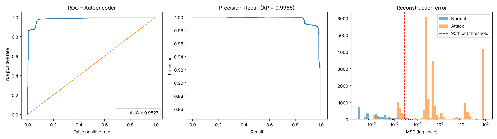

# Anomaly Detection for Industrial IoT Cybersecurity

Master's thesis project, MEng in Machine Intelligence and Data Science, Arcada University of Applied Sciences (2026).

**Thesis:** *Machine Learning-Based Anomaly Detection for Cybersecurity in Industrial IoT Environments: Evaluation of Autoencoder, Isolation Forest, and Extreme Learning Machine Approaches Using the TON-IoT Dataset*. Defended on 19 May 2026.

## The question
Signature-based intrusion detection cannot recognise attacks it has never seen, and labelled attack data is scarce in industrial networks. Can a model that learns only what *normal* traffic looks like detect a DDoS attack, and how should its alert threshold be set to balance missed attacks against false alarms?

## Approach
- **Data:** Zeek `conn` network logs from the TON_IoT dataset: one normal capture and one DDoS capture.
- **Models:**
  - **Autoencoder** (64-32-16-32-64), trained only on normal traffic, which flags connections it reconstructs poorly
  - **Isolation Forest**, an unsupervised baseline
  - **Extreme Learning Machine**, a supervised comparison
- **Evaluation:** precision, recall, F1, false-positive rate and ROC-AUC at several alert thresholds.

## Results (corrected analysis)

| Model | ROC-AUC | Precision | Recall | False-positive rate |
|---|---|---|---|---|
| Autoencoder, 95th percentile threshold | 0.983 | 0.990 | 0.885 | 5.3% |
| Autoencoder, 90th percentile threshold | 0.983 | 0.981 | 0.979 | 11.0% |
| Isolation Forest, trained on normal traffic | 0.767 | 0.938 | 0.151 | 5.7% |
| ELM (supervised) | 0.996 | 0.993 | 0.993 | 4.1% |

An autoencoder trained only on normal traffic detects DDoS connections well. The alert threshold is the main operational lever: moving from the 95th to the 90th percentile raises recall from 89% to 98%, at the cost of doubling false alarms from 5% to 11%.



## Why there are two sets of notebooks
After submitting the thesis, I reviewed the analysis and found problems that affect the reported figures, including:
- about 10% of "attack" rows that were really normal traffic
- the timestamp used as a model feature, although the two captures were recorded three weeks apart
- unseeded training, so results changed on every run
- alert thresholds set on the test set

`notebooks/original/` keeps the notebooks exactly as used for the thesis. `notebooks/corrected/` fixes these issues and re-runs everything with fixed seeds. [`README_corrections.md`](notebooks/corrected/README_corrections.md) lists every change and compares the results with the submitted thesis. The main conclusion holds, and is stronger after correction. The thesis's Isolation Forest results could not be reproduced.

## Repository structure
```
notebooks/original/     notebooks as used for the submitted thesis
notebooks/corrected/    corrected, seeded pipeline: 02 → 03 → 04 → 05
  results/              saved metrics and scores
  figures/              charts produced by the corrected notebooks
thesis/                 thesis PDF and defence slides
data/                   where to place the TON_IoT data (not included)
```

## Run it
1. Download the data as described in [`data/README.md`](data/README.md).
2. Install the requirements: `pip install pandas numpy scikit-learn matplotlib tensorflow hpelm jupyter`
3. Run the notebooks in `notebooks/corrected/` in order: `02` → `03` → `04` → `05`.

## Data source and citation
TON_IoT datasets, UNSW Canberra. Free for academic research use.
- Moustafa, N. (2021). A new distributed architecture for evaluating AI-based security systems at the edge: Network TON_IoT datasets. *Sustainable Cities and Society*, 72, 102994. https://doi.org/10.1016/j.scs.2021.102994
- Alsaedi, A., Moustafa, N., Tari, Z., Mahmood, A., & Anwar, A. (2020). TON_IoT telemetry dataset: A new generation dataset of IoT and IIoT for data-driven intrusion detection systems. *IEEE Access*, 8, 165130–165150.

## Author
Arushi Sharma · [Portfolio](https://arushi-sharma.notion.site/Hey-there-I-am-Arushi-318d5a056b7080bea33edb8dc09f7d61) · [GitHub](https://github.com/Arushi-dev)
